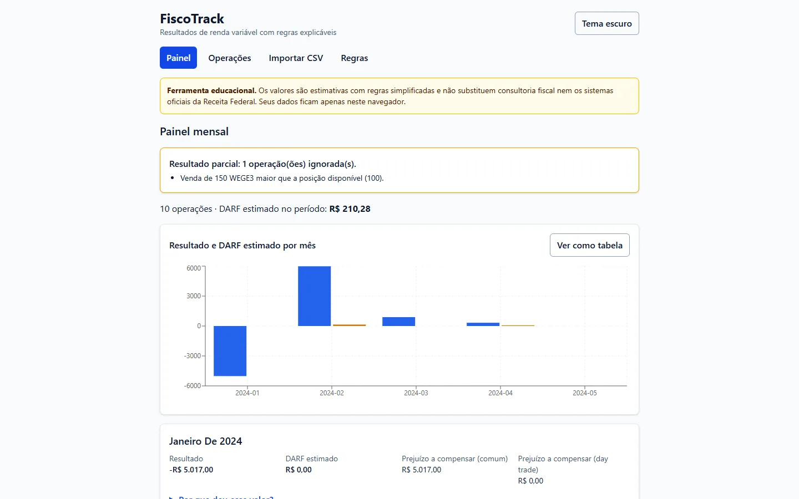
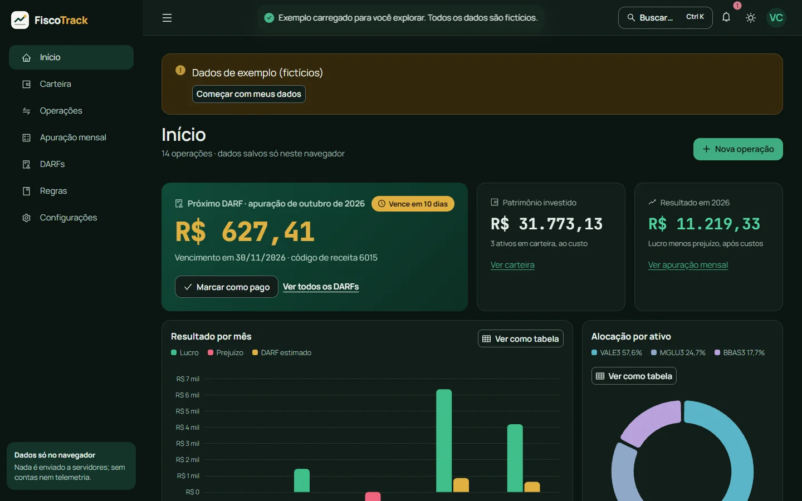
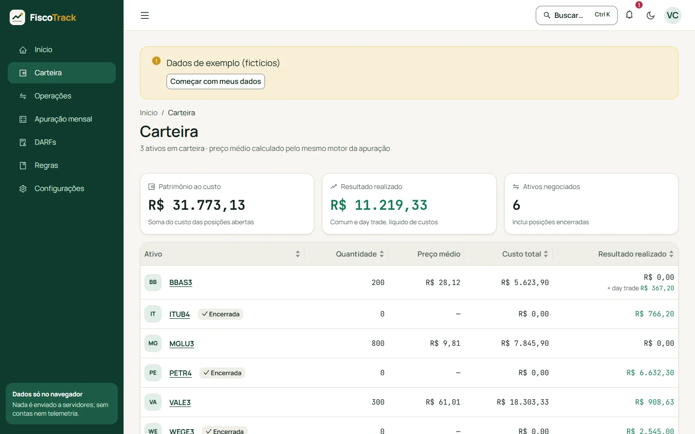
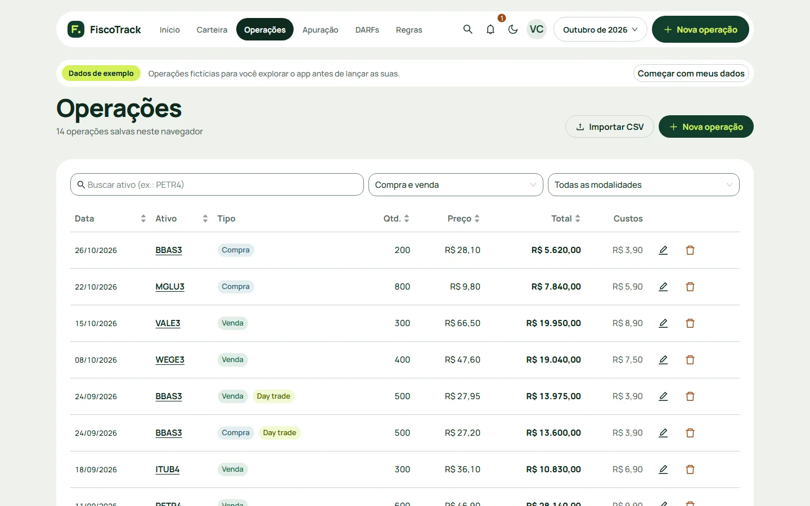
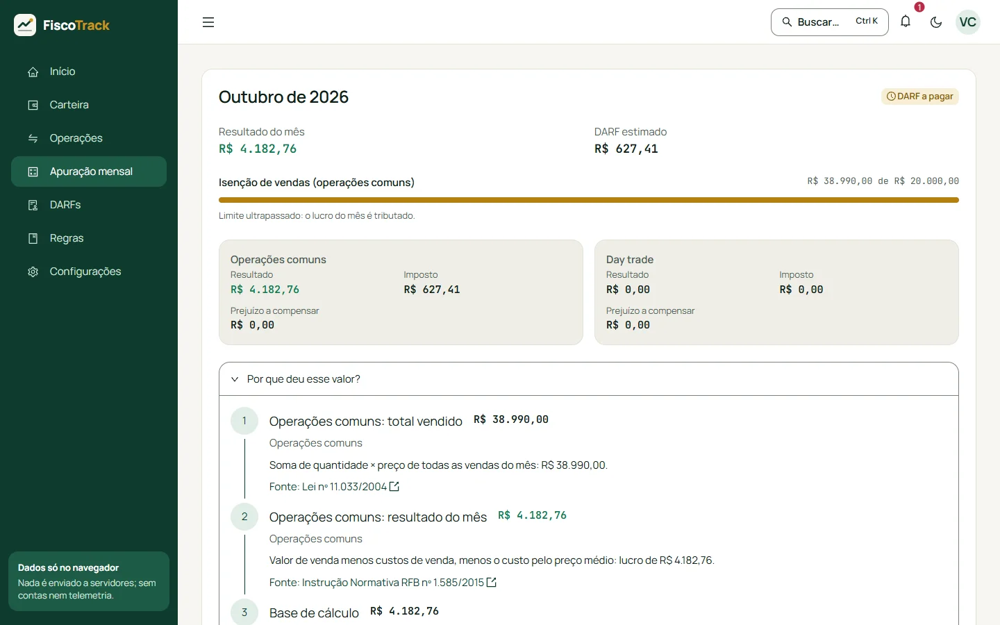
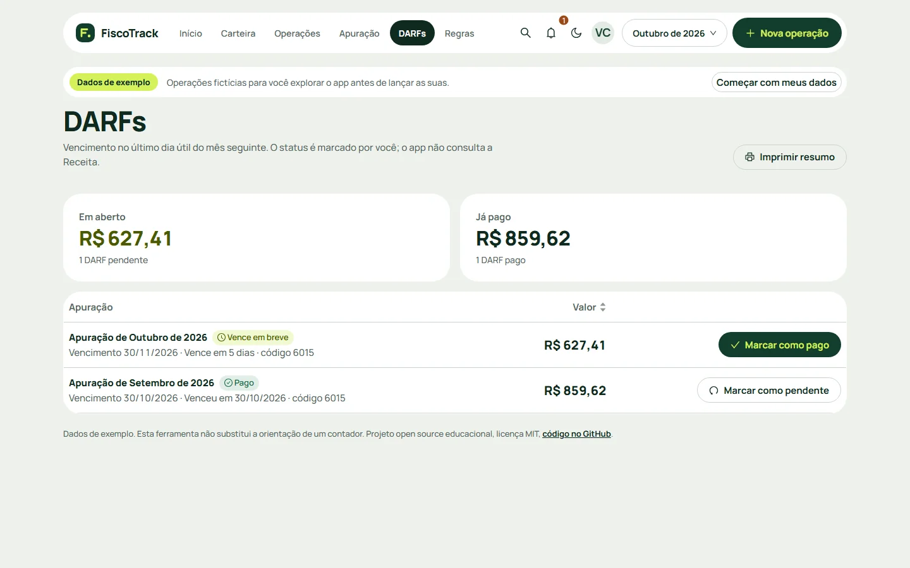
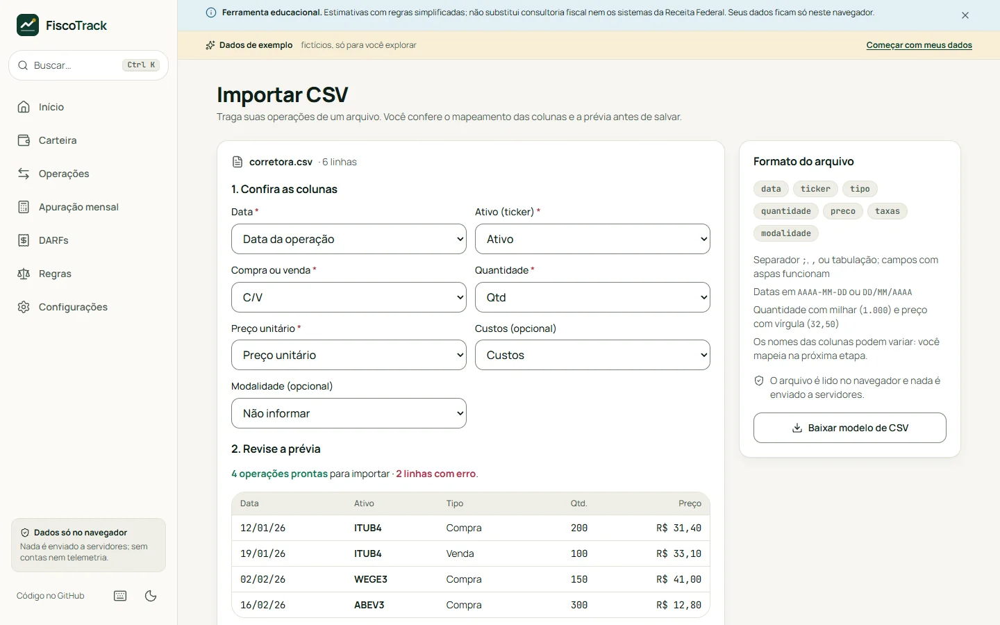
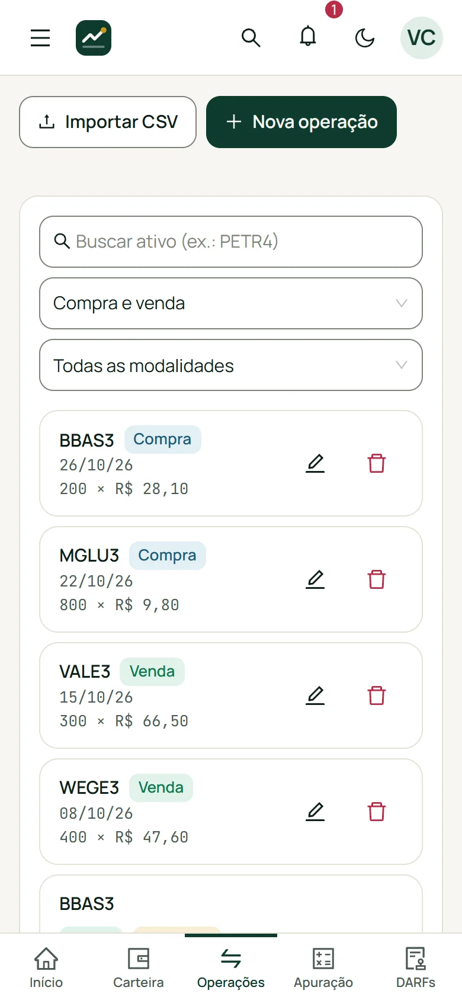
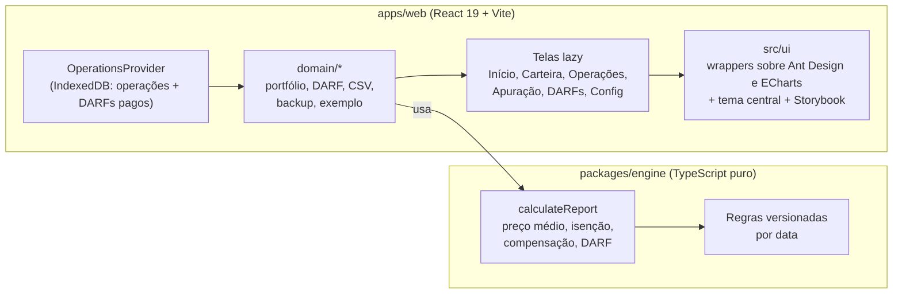

# FiscoTrack

[](https://github.com/NasckDev/fiscotrack/actions/workflows/ci.yml)
[](https://github.com/NasckDev/fiscotrack/actions/workflows/deploy.yml)
[](LICENSE)

**Imposto de renda variável sem susto.** O FiscoTrack organiza suas operações em ações, calcula o
resultado de cada mês, mostra quanto de DARF você deve e **explica a conta passo a passo**, com a
fonte legal de cada passo. Tudo roda no navegador: seus dados não saem do seu aparelho.

**Demo:** https://nasckdev.github.io/fiscotrack/ (abre com operações de exemplo, todas fictícias).

> **Aviso:** projeto **educacional**. Usa regras brasileiras **simplificadas** e não é consultoria
> fiscal nem substitui os sistemas oficiais da Receita Federal. Confira sempre a legislação vigente.

## Telas

Interface em Ant Design 6 com a identidade do FiscoTrack (verde-floresta, creme, menta, rosa e
dourado), claro e escuro, 1440 px no desktop e 390 px no celular.

| Início (claro)                                                                                       | Início (escuro)                                                                  |
| ---------------------------------------------------------------------------------------------------- | -------------------------------------------------------------------------------- |
|  |       |
|                  |  |
|      |                    |
|    |        |

No celular (390x844): barra inferior, listas de cards no lugar das tabelas e formulário em gaveta.




## O que faz

- **Início:** próximo DARF com contagem até o vencimento, patrimônio investido, resultado do ano,
  resultado mensal em barras, resultado acumulado em linha e alocação por ativo em rosca. Todo
  gráfico tem alternativa em tabela e descrição para leitor de tela.
- **Carteira:** posições com preço médio, quantidade, custo e resultado realizado; detalhe do ativo
  com histórico e evolução do preço médio.
- **Operações:** busca e filtros, incluir, **editar**, excluir com **desfazer**, exportar CSV.
- **Importar CSV:** escolha o arquivo, **mapeie as colunas** (o app sugere pelos nomes), confira a
  prévia e veja **erros por linha** sem perder as linhas válidas.
- **Apuração mensal:** operações comuns separadas de day trade, **barra da isenção de R$ 20 mil**,
  prejuízo a compensar e **"Por que deu esse valor?"** passo a passo com as fontes.
- **DARFs:** vencimento (último dia útil do mês seguinte), código 6015, status pago/pendente
  marcado por você e resumo para imprimir.
- **Configurações:** tema claro/escuro, **backup JSON** (exportar e restaurar, validado com Zod) e
  apagar dados.
- **Produtividade:** paleta de comandos (`Ctrl/⌘ K`), atalhos de teclado (`?` lista todos:
  `G` + letra navega, `N` cria operação).
- **Primeira visita:** abre com dados de exemplo (fictícios), com selo "Dados de exemplo" e a saída
  "Começar com meus dados" (confirma e permite desfazer). Quem apagou tudo de propósito não recebe o
  exemplo de novo.
- **Robustez:** operações do mesmo dia seguem a ordem de criação (`seq`); importação com CSV no padrão
  RFC 4180, milhar na quantidade, detecção de repetidas e ids determinísticos; falhas de gravação
  avisam o que fazer; backup validado e confirmado antes de restaurar; sincronização entre abas;
  `ErrorBoundary` com "Recarregar" e "Exportar backup"; lembrete de backup e uso de espaço.
- **Dados locais** (IndexedDB). Nada é enviado a servidores; sem contas e sem telemetria.

## Identidade visual e acessibilidade

- **Padrão de UI:** Ant Design 6 e Apache ECharts 6, sempre através dos wrappers de
  `apps/web/src/ui/` ([ADR 0009](docs/adr/0009-ui-com-ant-design-echarts-e-wrappers.md)). Uma regra
  de lint (`no-restricted-imports`) barra `antd`, `@ant-design/*` e `echarts*` fora dessa pasta.
- **Tema central** (`src/ui/theme`): a paleta da marca (verde-floresta `#0E3B2E`, creme `#F7F6F1`,
  menta para ganho, rosa para perda e dourado para DARF) vira tokens do Ant Design, claro e escuro com
  `theme.darkAlgorithm`. Manrope na interface e **JetBrains Mono tabular nos valores** (fontes
  auto-hospedadas, sem requisição externa).
- **Contraste AA calculado** nos dois temas: `test/contrast.test.ts` confere 90 pares de texto,
  interface e gráficos (texto ≥ 4,5:1; interface ≥ 3:1) a partir do mesmo arquivo de paleta que gera
  o tema.
- **Teclado e leitor de tela:** foco visível, link "Pular para o conteúdo", diálogos do Ant Design
  com foco preso, Esc e retorno do foco, erros ligados ao campo, avisos com `role`, selos de status
  sempre com ícone e texto, gráficos com descrição e **tabela equivalente** ("Ver como tabela").
- **Celular:** menu lateral vira gaveta, barra inferior com `safe-area-inset`, tabelas viram listas de
  cards, formulário numa gaveta inferior com ações fixas e alvos de 44 px (`controlHeight`).
- **Movimento** (contador do DARF, gráficos que se desenham, transições do Ant Design) desligado com
  `prefers-reduced-motion`.
- **axe-core** sem violações nas 9 telas, nos dois temas, em 360 e 1440 px (E2E), além de diálogo
  aberto, paleta de comandos e estado vazio.

## Regras modeladas (simplificadas)

Ações no mercado à vista, pessoa física — detalhes e premissas em
[packages/engine/src/rules/brRendaVariavel.ts](packages/engine/src/rules/brRendaVariavel.ts):

| Regra                     | Valor no projeto                                        | Observação                                                 |
| ------------------------- | ------------------------------------------------------- | ---------------------------------------------------------- |
| Custo médio               | Preço médio ponderado, custos de compra incluídos       | Custos de venda reduzem o valor de venda                   |
| Alíquota operações comuns | 15%                                                     | configurável                                               |
| Alíquota day trade        | 20%                                                     | configurável                                               |
| Isenção                   | Vendas de ações (operações comuns) até R$ 20.000,00/mês | configurável; considera valor bruto de venda               |
| Compensação de prejuízo   | Por categoria (comum × day trade), sem prazo            | prejuízo em mês isento compensável (premissa configurável) |
| DARF mínimo               | R$ 10,00; abaixo disso acumula para o mês seguinte      | configurável                                               |
| Vencimento do DARF        | Último dia útil do mês seguinte                         | só fins de semana; feriados não são modelados              |

Fontes citadas: Lei nº 11.033/2004, IN RFB nº 1.585/2015 e orientações da Receita Federal.
**Fora do escopo:** IRRF ("dedo-duro"), FIIs, ETFs, BDRs, opções, eventos corporativos
(desdobramento, bonificação), cotação de mercado (a carteira usa o custo) e detecção automática de
day trade (a modalidade vem do CSV ou do formulário).

## Arquitetura



```
packages/engine   TypeScript puro, sem dependências: preço médio, apuração mensal, isenção,
                  compensação de prejuízo, DARF estimado, explicação passo a passo, regras por data
apps/web          React 19 + Vite + React Router (HashRouter) + Zod + idb + Ant Design + ECharts
apps/web/src/ui   Wrappers (AppButton, AppTable, AppCard, AppForm, AppModal, AppChart...), tema e stories
apps/web/e2e      Playwright + axe-core
docs/adr          Decisões de arquitetura
```

- `calculateReport(operations, ruleSets?)` é uma função pura: dinheiro em **centavos inteiros**,
  alíquotas em **pontos-base**, arredondamento half-up explícito. **O motor não mudou** nesta versão.
- Carteira e DARFs são **derivados** das operações com as mesmas funções do motor; só o status
  "pago" é salvo ([ADR 0007](docs/adr/0007-dados-derivados-e-darf-pago.md)).
- Operações problemáticas (venda sem posição, data sem regra) viram `issues` e o relatório é
  marcado como **parcial**, nunca um cálculo silencioso.

ADRs: [motor puro](docs/adr/0001-motor-de-calculo-puro.md) ·
[regras versionadas](docs/adr/0002-regras-versionadas-por-data.md) ·
[dados locais](docs/adr/0003-dados-locais-por-padrao.md) ·
[CSV com erros por linha](docs/adr/0004-importacao-csv-com-erros-por-linha.md) ·
[identidade visual própria](docs/adr/0005-identidade-visual-propria.md) ·
[E2E com axe](docs/adr/0006-e2e-com-axe-e-build-portatil.md) ·
[dados derivados e DARF pago](docs/adr/0007-dados-derivados-e-darf-pago.md) ·
[ordem estável, ids determinísticos e escritas seguras](docs/adr/0008-ordem-estavel-ids-deterministicos-e-escritas-seguras.md) ·
[Ant Design, ECharts e wrappers](docs/adr/0009-ui-com-ant-design-echarts-e-wrappers.md)

### Camada de UI e Storybook

Nenhuma tela usa componente do Ant Design diretamente. Os wrappers de `apps/web/src/ui` seguem o
contrato `App*` (por exemplo `AppButton` com `variant`, `size`, `loading`, `disabled`, `icon` e
`danger`): AppButton, AppIconButton, AppInput, AppSelect, AppCheckbox, AppSwitch, AppDatePicker,
AppForm/AppFormItem, AppTable (vira lista de cards no celular), AppList, AppCard, AppStatistic,
AppTag/AppStatus, AppMoney, AppModal, AppDrawer, AppConfirm, AppToast, AppSteps, AppEmpty,
AppSkeleton, AppAlert, AppUpload, AppCollapse, AppProgress, AppTabBar, AppPagination, AppTabs,
AppMenu, AppDropdown, AppTooltip, AppPopover, AppBreadcrumb, AppSegmented, AppResult,
AppDescriptions, AppAvatar, AppBadge, layout e tipografia, e AppChart com `AppBarChart`,
`AppLineChart` e `AppDonutChart` (ECharts com `echarts/core` enxuto e renderizador SVG).

Cada wrapper tem `.stories.tsx` na mesma pasta, com estados (padrão, desabilitado, carregando, erro,
vazio) e controles. O Storybook aplica o tema do app (alternável claro/escuro na barra) e o addon
de acessibilidade:

```bash
npm run storybook -w @fiscotrack/web         # http://localhost:6006
npm run build-storybook                      # gera apps/web/storybook-static (roda no CI)
```

## Como rodar

Requisitos: Node.js 20+.

```bash
npm install
npm run dev            # app em http://localhost:5173
npm test               # testes de todos os pacotes
npm run test:coverage  # cobertura (engine exige ≥ 90%)
npm run lint && npm run format:check && npm run typecheck && npm run build
npm run build-storybook
npm run build:portable && npm run test:e2e -w @fiscotrack/web   # E2E + axe
```

Para os E2E usando o Chrome já instalado: `PW_CHANNEL=chrome npm run test:e2e -w @fiscotrack/web`
(a porta vem de `E2E_PORT`). Em outra máquina, instale o navegador antes: `npx playwright install chromium`.

### Build portátil (qualquer subcaminho)

```bash
npm run build:portable   # gera apps/web/dist-portable
```

A pasta usa caminhos relativos (`base: './'`) e rotas por hash, então funciona servida em qualquer
subcaminho, por exemplo `/projetos/fiscotrack/`, sem fallback de servidor.

### Formato do CSV

```csv
data;ticker;tipo;quantidade;preco;taxas;modalidade
2026-01-08;PETR4;compra;100;38,20;4,90;comum
```

Separador `;` ou `,`; datas `AAAA-MM-DD` ou `DD/MM/AAAA`; `tipo` = `compra`|`venda`; `modalidade` =
`comum`|`daytrade`. Os nomes das colunas podem variar (`Ativo`, `Qtd`, `C/V`…): você confirma o
mapeamento antes de importar.

## Testes e desempenho

| Verificação                                  | Resultado                                                                                                                                   |
| -------------------------------------------- | ------------------------------------------------------------------------------------------------------------------------------------------- |
| Testes do motor (Vitest, table-driven)       | 73 passando (o motor e seus testes não mudaram)                                                                                             |
| Testes da web (Vitest + Testing Library)     | 197 passando: domínio, fluxos de interface (26 de componente) e 90 pares de contraste AA                                                    |
| E2E (Playwright, desktop 1440 e celular 360) | 26 execuções (13 cenários nos dois formatos): 24 passam e 2 são pulados de propósito (atalhos de teclado só no desktop, menu só no celular) |
| Acessibilidade (axe, WCAG 2.2 AA)            | 0 violações nas 9 telas, tema claro e escuro, em 360 e 1440 px, com diálogo aberto, paleta de comandos e estado vazio                       |
| Geometria dos diálogos (E2E)                 | Modal, gaveta e confirmação cabem na viewport, com o botão de salvar visível, e o foco volta para quem abriu                                |
| Stories (Storybook 10 + addon a11y)          | Todos os wrappers, com estados e controles; `build-storybook` no CI                                                                         |

### Bundle: antes e depois

Medido no build portátil (`apps/web/dist-portable`), JavaScript carregado na primeira tela:

| Medida                            | Antes (Tailwind + Recharts + lucide + motion) | Depois (Ant Design + ECharts)            |
| --------------------------------- | --------------------------------------------- | ---------------------------------------- |
| JS inicial                        | 430 kB (140 kB gzip)                          | **1.442 kB (455 kB gzip)**               |
| CSS inicial                       | 49 kB (14 kB gzip)                            | **10 kB (6 kB gzip)**                    |
| Gráficos (carregam só com a tela) | Recharts, ~412 kB                             | ECharts enxuto, **592 kB (202 kB gzip)** |

O Ant Design é pesado: o JavaScript inicial triplicou, o CSS caiu porque o estilo agora vem do
CSS-in-JS dos componentes. O que foi feito para conter o custo: imports nomeados por componente,
rotas e gráficos carregados sob demanda (o ECharts fica fora do índice de `ui` para não entrar na
primeira tela), `echarts/core` com só barras, linha e rosca, renderizador SVG e remoção de
Tailwind, Recharts, lucide-react e motion. Não há como remover o custo do Ant Design sem abandonar o
padrão de UI.

Casos do motor: zero operações, somente compras, custos de compra e venda, isenção (abaixo, exatamente
no limite e um centavo acima), prejuízo acumulado e compensação, day trade separado de operações
comuns, DARF abaixo do mínimo, arredondamento, ordenação por data, regras versionadas e relatório
parcial.

## Dependências e licenças

Versões exatas no `package.json`; `npm audit` sem vulnerabilidade alta ou crítica em produção.

| Pacote                                              | Uso                                      | Licença                |
| --------------------------------------------------- | ---------------------------------------- | ---------------------- |
| antd 6.7.1                                          | Componentes (só via `src/ui`)            | MIT                    |
| @ant-design/icons 6.3.4                             | Ícones                                   | MIT                    |
| dayjs 1.11.23                                       | Datas do seletor de data                 | MIT                    |
| echarts 6.1.0                                       | Gráficos (`echarts/core` enxuto)         | Apache-2.0             |
| echarts-for-react 3.1.0                             | Ciclo de vida do gráfico no React        | MIT                    |
| react, react-dom 19.3.1                             | Interface                                | MIT                    |
| react-router 8.5.2                                  | Rotas por hash                           | MIT                    |
| zod 4.6.7                                           | Validação de CSV, backup e formulário    | MIT                    |
| idb 8.0.4                                           | IndexedDB                                | ISC (permissiva)       |
| @fontsource-variable/manrope, jetbrains-mono 5.3.0  | Fontes auto-hospedadas                   | OFL-1.1 (fontes)       |
| storybook, @storybook/react-vite, addon-a11y 10.6.8 | Storybook (desenvolvimento)              | MIT                    |
| @playwright/test 1.65.1                             | E2E (desenvolvimento)                    | Apache-2.0             |
| @axe-core/playwright 4.14.0                         | Acessibilidade nos E2E (desenvolvimento) | MPL-2.0 (só em testes) |

Tailwind, Recharts, lucide-react e motion foram removidos; não há motivo para mantê-los.

## Licença

[MIT](LICENSE) © Alexandre Diogo Nascimento
