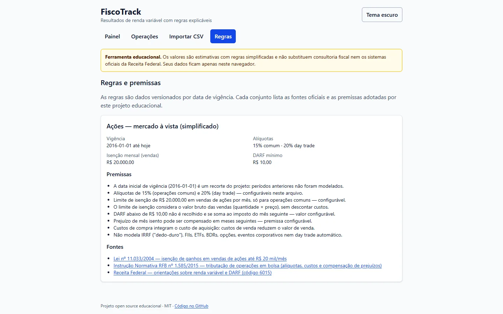
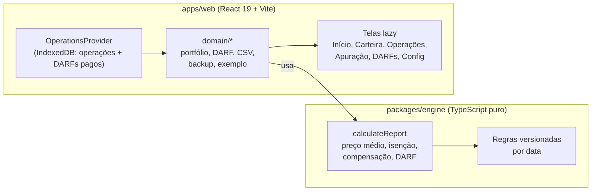

# FiscoTrack

[](https://github.com/NasckDev/fiscotrack/actions/workflows/ci.yml)
[](https://github.com/NasckDev/fiscotrack/actions/workflows/deploy.yml)
[](LICENSE)

**Imposto de renda variável sem susto.** O FiscoTrack organiza suas operações em ações, calcula o
resultado de cada mês, mostra quanto de DARF você deve e **explica a conta passo a passo**, com a
fonte legal de cada passo. Tudo roda no navegador: seus dados não saem do seu aparelho.

**Demo:** https://nasckdev.github.io/fiscotrack/ (abre com operações de exemplo, todas fictícias).

> **Aviso:** projeto **educacional**. Usa regras brasileiras **simplificadas** e não é consultoria
> fiscal nem substitui os sistemas oficiais da Receita Federal. Confira sempre a legislação vigente.

## Telas

| Início (claro)                                                                                          | Início (escuro)                                                                                    |
| ------------------------------------------------------------------------------------------------------- | -------------------------------------------------------------------------------------------------- |
|     |                         |
|         |  |
|  |                          |

No celular (390x844):


## O que faz

- **Início:** próximo DARF com contagem até o vencimento, patrimônio investido, resultado do ano,
  resultado mensal em barras, resultado acumulado em linha e alocação por ativo em rosca. Todo
  gráfico tem alternativa em tabela e descrição para leitor de tela.
- **Carteira:** posições com preço médio, quantidade, custo e resultado realizado; detalhe do ativo
  com histórico e evolução do preço médio.
- **Operações:** busca e filtros, incluir, **editar**, excluir com **desfazer**, exportar CSV.
- **Importar CSV:** escolha o arquivo, **mapeie as colunas** (o app sugere pelos nomes), confira a
  prévia e veja **erros por linha** sem perder as linhas válidas.
- **Apuração mensal:** operações comuns separadas de day trade, **barra da isenção de R$ 20 mil**,
  prejuízo a compensar e **"Por que deu esse valor?"** passo a passo com as fontes.
- **DARFs:** vencimento (último dia útil do mês seguinte), código 6015, status pago/pendente
  marcado por você e resumo para imprimir.
- **Configurações:** tema claro/escuro, **backup JSON** (exportar e restaurar, validado com Zod) e
  apagar dados.
- **Produtividade:** paleta de comandos (`Ctrl/⌘ K`), atalhos de teclado (`?` lista todos:
  `G` + letra navega, `N` cria operação).
- **Primeira visita:** abre com dados de exemplo (fictícios), com selo "Dados de exemplo" e a saída
  "Começar com meus dados" (confirma e permite desfazer). Quem apagou tudo de propósito não recebe o
  exemplo de novo.
- **Robustez:** operações do mesmo dia seguem a ordem de criação (`seq`); importação com CSV no padrão
  RFC 4180, milhar na quantidade, detecção de repetidas e ids determinísticos; falhas de gravação
  avisam o que fazer; backup validado e confirmado antes de restaurar; sincronização entre abas;
  `ErrorBoundary` com "Recarregar" e "Exportar backup"; lembrete de backup e uso de espaço.
- **Dados locais** (IndexedDB). Nada é enviado a servidores; sem contas e sem telemetria.

## Identidade visual e acessibilidade

- **Marca própria:** verde-floresta `#0E3B2E`, creme `#F7F6F1`, menta para ganho, rosa para perda e
  dourado para DARF. Manrope na interface e JetBrains Mono nos valores (fontes auto-hospedadas,
  sem requisição externa). Tokens em `apps/web/src/styles/theme.css`
  ([ADR 0005](docs/adr/0005-identidade-visual-propria.md)).
- **Contraste AA calculado** nos dois temas: `node scripts/contrast.mjs` confere 38 pares de
  texto e de interface.
- **Teclado e leitor de tela:** foco visível, link "Pular para o conteúdo", diálogos nativos
  (`<dialog>`, com foco preso e Esc), erros ligados ao campo (`aria-describedby`), regiões vivas
  para avisos, selos de status sempre com ícone e texto.
- **Mobile:** barra inferior com alvos de 44px e `safe-area-inset`; tabelas viram listas de cards.
- **Movimento** (entradas escalonadas, contadores, gráficos que se desenham) desligado com
  `prefers-reduced-motion`.
- **axe-core** sem violações nas 9 telas, nos dois temas (E2E).

## Regras modeladas (simplificadas)

Ações no mercado à vista, pessoa física — detalhes e premissas em
[packages/engine/src/rules/brRendaVariavel.ts](packages/engine/src/rules/brRendaVariavel.ts):

| Regra                     | Valor no projeto                                        | Observação                                                 |
| ------------------------- | ------------------------------------------------------- | ---------------------------------------------------------- |
| Custo médio               | Preço médio ponderado, custos de compra incluídos       | Custos de venda reduzem o valor de venda                   |
| Alíquota operações comuns | 15%                                                     | configurável                                               |
| Alíquota day trade        | 20%                                                     | configurável                                               |
| Isenção                   | Vendas de ações (operações comuns) até R$ 20.000,00/mês | configurável; considera valor bruto de venda               |
| Compensação de prejuízo   | Por categoria (comum × day trade), sem prazo            | prejuízo em mês isento compensável (premissa configurável) |
| DARF mínimo               | R$ 10,00; abaixo disso acumula para o mês seguinte      | configurável                                               |
| Vencimento do DARF        | Último dia útil do mês seguinte                         | só fins de semana; feriados não são modelados              |

Fontes citadas: Lei nº 11.033/2004, IN RFB nº 1.585/2015 e orientações da Receita Federal.
**Fora do escopo:** IRRF ("dedo-duro"), FIIs, ETFs, BDRs, opções, eventos corporativos
(desdobramento, bonificação), cotação de mercado (a carteira usa o custo) e detecção automática de
day trade (a modalidade vem do CSV ou do formulário).

## Arquitetura



```
packages/engine   TypeScript puro, sem dependências: preço médio, apuração mensal, isenção,
                  compensação de prejuízo, DARF estimado, explicação passo a passo, regras por data
apps/web          React 19 + Vite + React Router (HashRouter) + Zod + idb + Recharts + Tailwind 4
                  + lucide-react + motion
apps/web/e2e      Playwright + axe-core
docs/adr          Decisões de arquitetura
```

- `calculateReport(operations, ruleSets?)` é uma função pura: dinheiro em **centavos inteiros**,
  alíquotas em **pontos-base**, arredondamento half-up explícito. **O motor não mudou** nesta versão.
- Carteira e DARFs são **derivados** das operações com as mesmas funções do motor; só o status
  "pago" é salvo ([ADR 0007](docs/adr/0007-dados-derivados-e-darf-pago.md)).
- Operações problemáticas (venda sem posição, data sem regra) viram `issues` e o relatório é
  marcado como **parcial** — nunca um cálculo silencioso.

ADRs: [motor puro](docs/adr/0001-motor-de-calculo-puro.md) ·
[regras versionadas](docs/adr/0002-regras-versionadas-por-data.md) ·
[dados locais](docs/adr/0003-dados-locais-por-padrao.md) ·
[CSV com erros por linha](docs/adr/0004-importacao-csv-com-erros-por-linha.md) ·
[identidade visual própria](docs/adr/0005-identidade-visual-propria.md) ·
[E2E com axe](docs/adr/0006-e2e-com-axe-e-build-portatil.md) ·
[dados derivados e DARF pago](docs/adr/0007-dados-derivados-e-darf-pago.md) ·
[ordem estável, ids determinísticos e escritas seguras](docs/adr/0008-ordem-estavel-ids-deterministicos-e-escritas-seguras.md)

## Como rodar

Requisitos: Node.js 20+.

```bash
npm install
npm run dev            # app em http://localhost:5173
npm test               # testes de todos os pacotes
npm run test:coverage  # cobertura (engine exige ≥ 90%)
npm run lint && npm run format:check && npm run typecheck && npm run build
npm run build:portable && npm run test:e2e -w @fiscotrack/web   # E2E + axe
node scripts/contrast.mjs                                        # contraste AA dos temas
```

Para os E2E usando o Chrome já instalado: `PW_CHANNEL=chrome npm run test:e2e -w @fiscotrack/web`.
Em outra máquina, instale o navegador antes: `npx playwright install chromium`.

### Build portátil (qualquer subcaminho)

```bash
npm run build:portable   # gera apps/web/dist-portable
```

A pasta usa caminhos relativos (`base: './'`) e rotas por hash, então funciona servida em qualquer
subcaminho, por exemplo `/projetos/fiscotrack/`, sem fallback de servidor.

### Formato do CSV

```csv
data;ticker;tipo;quantidade;preco;taxas;modalidade
2026-01-08;PETR4;compra;100;38,20;4,90;comum
```

Separador `;` ou `,`; datas `AAAA-MM-DD` ou `DD/MM/AAAA`; `tipo` = `compra`|`venda`; `modalidade` =
`comum`|`daytrade`. Os nomes das colunas podem variar (`Ativo`, `Qtd`, `C/V`…): você confirma o
mapeamento antes de importar.

## Testes e desempenho

| Verificação                              | Resultado                                                                                                                                                                                   |
| ---------------------------------------- | ------------------------------------------------------------------------------------------------------------------------------------------------------------------------------------------- |
| Testes do motor (Vitest, table-driven)   | 73 passando                                                                                                                                                                                 |
| Testes da web (Vitest + Testing Library) | 107 passando: domínio (DARF, carteira, backup, mapeamento de CSV, exemplo, formatação) e fluxos de interface                                                                                |
| E2E (Playwright, desktop e celular)      | 24 execuções (12 cenários em desktop e celular): primeira visita, CRUD com desfazer, importação, backup, paleta, rota interna e axe em todas as telas, com diálogo aberto e no estado vazio |
| Acessibilidade (axe, WCAG 2.2 AA)        | 0 violações nas 9 telas, tema claro e escuro, em 390 e 1440 px                                                                                                                              |
| Contraste (scripts/contrast.mjs)         | 38 pares aprovados (texto ≥ 4,5:1; interface ≥ 3:1)                                                                                                                                         |
| Bundle inicial (build portátil)          | JS 430 kB (140 kB gzip) e CSS 49 kB (14 kB gzip); gráficos (Recharts, ~412 kB) e cada tela carregam sob demanda                                                                             |

Casos do motor: zero operações, somente compras, custos de compra e venda, isenção (abaixo, exatamente
no limite e um centavo acima), prejuízo acumulado e compensação, day trade separado de operações
comuns, DARF abaixo do mínimo, arredondamento, ordenação por data, regras versionadas e relatório
parcial.

## Licença

[MIT](LICENSE) © Alexandre Diogo Nascimento
